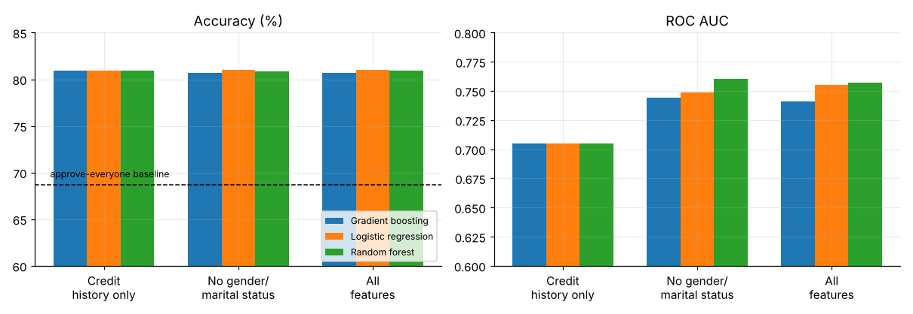

# Loan approval prediction: what actually drives the decision?

**614 loan applications, evaluated with repeated cross-validation and a protected-attribute check.**

Which applicant details drive a loan decision, and does a machine-learning model add anything over a simple rule? A logistic regression reaches about **81% accuracy** against a 68.7% "approve everyone" baseline, but almost all of it comes from one variable, **credit history**. A rule using nothing else scores 80.9%.

**Tools:** Python · pandas · scikit-learn · matplotlib

📓 **Full analysis:** [`notebooks/loan_approval_prediction.ipynb`](notebooks/loan_approval_prediction.ipynb) (also as [HTML](loan_approval_prediction.html))

## Key findings

| # | Finding | Evidence |
|---|---|---|
| 1 | Credit history explains the decisions. | 80% approval with good history vs 8% with bad; permutation importance 18 points of accuracy for credit history, under 0.3 for every other input. |
| 2 | Extra features improve ranking, not accuracy. | Accuracy 80.9% (history only) vs 81.0% (all features); ROC AUC 0.705 to about 0.75. |
| 3 | Model complexity buys nothing. | Logistic regression, random forest and gradient boosting all score 80.7-81.0% (25 cross-validation folds each, SD about 2 points). |
| 4 | Gender and marital status can be dropped at no cost. | Same accuracy and AUC with or without them; the model's group gaps (under 2 points) are far smaller than the historical gaps. |
| 5 | The model is lenient. | Approves 98% of truly approved applicants but also 56% of rejected ones; when it says "reject" it is right 92% of the time. Suits triage, not final decisions. |



## Method

1. **Audit.** 614 rows, 12 inputs, seven columns with missing values (up to 8% for credit history).
2. **Leak-free preprocessing.** Imputation, one-hot encoding and scaling live inside the cross-validation pipeline, so test folds never influence fill-in values.
3. **Repeated stratified cross-validation.** 5 folds x 5 repeats for three models on three feature sets, compared with the majority-class baseline.
4. **Error analysis and importance.** Out-of-fold confusion matrix; permutation importance on held-out folds.
5. **Group check.** Actual vs predicted approval rates by gender and marital status.

## Repository structure

```
├── data/loan_applications.csv
├── notebooks/loan_approval_prediction.ipynb
├── results/          # CSV tables written by the notebook
├── figures/
├── loan_approval_prediction.html
└── requirements.txt
```

## Reproduce

```bash
pip install -r requirements.txt
cd notebooks && jupyter notebook loan_approval_prediction.ipynb   # Run All (about a minute)
```

## Limitations

614 applications from one lender; only applicants are observed, so selection effects are unknown. Labels are the lender's past decisions, so the model learns the lender's behaviour, not who would actually repay. Fifty applicants have no credit history recorded. Group comparisons rest on small samples (112 women).

## Author

Timothy Rimu
